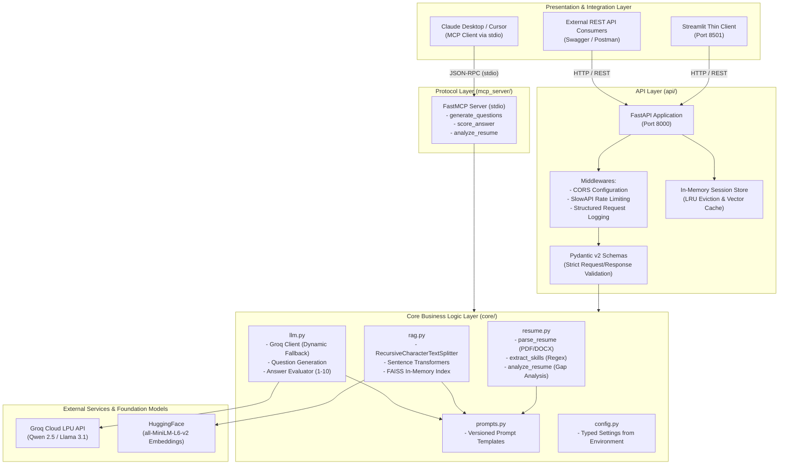

# 🎯 AI Interview Preparation Assistant

[](https://github.com/shubhamptdr001/AI-Interview-Assistant/actions)
[](https://fastapi.tiangolo.com)
[](https://streamlit.io)
[](https://groq.com)
[](https://modelcontextprotocol.io)
[](https://www.python.org)
[](https://www.docker.com)

A production-grade, full-stack Generative AI application engineered to help students and software job-seekers prepare for technical interviews. The platform combines **FastAPI**, **Streamlit**, **LangChain RAG (FAISS + Sentence Transformers)**, **Groq LPU inference**, and the **Model Context Protocol (MCP)** across a clean, decoupled layered architecture.

---

## 🔗 Live Application Placeholder
- **Web Interface:** `https://your-domain-or-cloudrun-url.run.app` *(Pending Cloud Deployment)*
- **Interactive OpenAPI Docs:** `https://your-backend-url.run.app/docs` *(Pending Cloud Deployment)*

---

## 📐 System Architecture

The project is structured following strict layered architecture principles: core domain logic is decoupled from presentation layers, allowing the same logic to power the **FastAPI REST API**, the **Streamlit Thin Client**, and the **Claude Desktop MCP Server** with zero duplication.



---

## ✨ Features

| Feature | Description | Architecture Component |
|---|---|---|
| 📄 **Resume Parsing & Gap Analysis** | Parses `.pdf` and `.docx` binary files, extracts skills against a curated skills bank, and produces a structured strengths/gap assessment. | `core/resume.py` & `POST /resume/analyze` |
| 💬 **Smart Resume Q&A (RAG)** | Chunks resumes with LangChain and builds an in-memory FAISS index to answer natural-language questions with source citations. | `core/rag.py` & `POST /resume/ask` |
| 🏢 **Targeted Company Questions** | Generates real, company-tailored interview questions categorized by Technical, HR, and Behavioral types. | `core/llm.py` & `POST /questions` |
| 🎤 **Dynamic Mock Interview** | Simulates a live interview round with single-question generation, automated scoring (1-10), and constructive critique in Hinglish/English. | `core/llm.py` & `POST /score` |
| 💻 **Coding Assistant** | Solves coding doubts and DSA concepts with clear beginner-friendly explanations and commented code. | `core/llm.py` & `POST /coding-help` |
| 🔌 **Model Context Protocol (MCP)** | Exposes interview prep and resume analysis tools directly to AI desktop assistants like Claude Desktop over standard I/O. | `mcp_server/server.py` |

---

## 🛠️ Tech Stack

- **Backend Framework:** FastAPI, Uvicorn, Pydantic v2
- **Frontend Client:** Streamlit, HTTPX
- **LLM Engine:** Groq API (Qwen 2.5 27B / Llama 3.1 8B/70B)
- **Vector Search & RAG:** LangChain, FAISS (CPU), Sentence Transformers (`all-MiniLM-L6-v2`)
- **Document Processing:** PyPDF2, python-docx
- **Protocol:** Model Context Protocol (FastMCP SDK)
- **Rate Limiting & Security:** SlowAPI, CORS Middleware, Non-root Docker execution
- **Testing:** Pytest, Pytest-Mock (100% offline suite)
- **Containerization & CI:** Docker, Docker Compose, GitHub Actions

---

## 📁 Repository Structure

```
AI-Interview-Assistant/
├── api/                       # FastAPI REST API Layer
│   ├── routes/                # Modular API route controllers
│   │   ├── health.py          # GET /health
│   │   ├── interview.py       # POST /questions, /score, /coding-help
│   │   └── resume.py          # POST /resume/upload, /resume/ask, /resume/analyze
│   ├── main.py                # App entrypoint, middleware, logging, exception handlers
│   ├── schemas.py             # Pydantic request and response schemas
│   └── state.py               # In-memory vector store session registry
├── client/                    # HTTP Client for Streamlit Frontend
│   └── api_client.py          # Typed API client wrapper communicating via HTTPX
├── core/                      # Pure Domain Logic (Zero UI Dependencies)
│   ├── config.py              # Typed environment configuration
│   ├── llm.py                 # Groq client, model auto-discovery, prompt runners
│   ├── prompts.py             # Centralized, versioned prompt templates
│   ├── rag.py                 # Text chunking, FAISS index creation, context retrieval
│   └── resume.py              # PDF/DOCX byte extraction, skill matching, gap analysis
├── data/                      # Domain Datasets
│   └── skills_bank.py         # Curated technical & soft skills dictionary
├── mcp_server/                # Model Context Protocol (MCP) Server
│   └── server.py              # FastMCP stdio server exposing tools to Claude Desktop
├── tests/                     # Automated Test Suite (100% Offline)
│   ├── conftest.py            # Pytest fixtures and synthetic file mocks
│   ├── test_api.py            # FastAPI TestClient endpoint integration tests
│   ├── test_core_llm.py       # Unit tests for question generation and scoring
│   ├── test_core_rag.py       # Unit tests for chunking and retrieval
│   ├── test_core_resume.py    # Unit tests for resume parsing and skill matching
│   └── test_mcp.py            # Smoke tests for MCP tool signatures and executions
├── .dockerignore              # Build exclusions
├── .env.example               # Environment variables template
├── .github/workflows/ci.yml   # GitHub Actions automated test & build pipeline
├── Dockerfile.api             # Production container for FastAPI backend
├── Dockerfile.ui              # Container for Streamlit thin client
├── docker-compose.yml         # Multi-container local orchestration
├── pytest.ini                 # Pytest configuration
├── render.yaml                # Infrastructure-as-code blueprint for Render
└── requirements.txt           # Unified project dependencies
```

---

## 🚀 Getting Started

### Prerequisites
- Python 3.11 or 3.12 installed
- Free Groq API Key from [console.groq.com/keys](https://console.groq.com/keys)
- Git and Docker (optional for containerized run)

### 1. Clone & Set Up Environment

```bash
git clone https://github.com/shubhamptdr001/AI-Interview-Assistant.git
cd AI-Interview-Assistant

# Create virtual environment
python -m venv venv

# Activate virtual environment
# Windows (PowerShell):
venv\Scripts\Activate.ps1
# Mac/Linux:
source venv/bin/activate

# Install dependencies
pip install -r requirements.txt
```

### 2. Configure Environment Variables

Copy the `.env.example` file to `.env`:

```bash
cp .env.example .env
```

Edit `.env` and paste your Groq API key:
```env
GROQ_API_KEY=gsk_your_actual_groq_api_key_here
GROQ_MODEL=qwen/qwen3.8-27b
BACKEND_URL=http://localhost:8000
```

---

## 🏃 Running the Application

### Option A: Local Processes (Fastest for Development)

Open **two terminal windows**:

**Terminal 1 (Start FastAPI Backend):**
```bash
uvicorn api.main:app --reload --host 0.0.0.0 --port 8000
```
*API will run at `http://localhost:8000` with Swagger docs at `http://localhost:8000/docs`.*

**Terminal 2 (Start Streamlit Thin Client):**
```bash
streamlit run app.py
```
*UI will open in your browser at `http://localhost:8501`.*

---

### Option B: Docker Compose (One-Command Run)

Run both services with automatic networking and healthchecks:

```bash
docker compose up --build
```

- **Frontend:** [http://localhost:8501](http://localhost:8501)
- **Backend API:** [http://localhost:8000](http://localhost:8000)
- **API Swagger Docs:** [http://localhost:8000/docs](http://localhost:8000/docs)

To shut down:
```bash
docker compose down
```

---

## 🔌 Model Context Protocol (MCP) Integration

The project includes an **MCP Server** (`mcp_server/server.py`) using the official Python SDK over `stdio`. This allows desktop AI applications (like **Claude Desktop** or **Cursor**) to use your interview tools as native agent capabilities.

### Exposed Tools
1. `generate_questions(company, role, count, difficulty)`: Returns targeted interview questions.
2. `score_answer(question, answer, role)`: Evaluates interview responses (score 1-10 + feedback).
3. `analyze_resume(resume_text, role)`: Performs skill detection and gap analysis on raw resume text.

### Registering with Claude Desktop

Open your Claude Desktop configuration file:
- **Windows:** `%APPDATA%\Claude\claude_desktop_config.json`
- **macOS:** `~/Library/Application Support/Claude/claude_desktop_config.json`

Add the server configuration (replace paths with your local system paths):

```json
{
  "mcpServers": {
    "interview-assistant": {
      "command": "python",
      "args": [
        "C:\\projects_\\AI-Interview-Assistant\\mcp_server\\server.py"
      ],
      "env": {
        "GROQ_API_KEY": "gsk_your_groq_api_key_here",
        "GROQ_MODEL": "qwen/qwen3.8-27b"
      }
    }
  }
}
```

### Example Claude Desktop Conversation

> **User:** "I have an interview coming up at Google for an AI Engineer role. Can you generate 3 medium-difficulty questions for me to practice?"
> 
> **Claude:** *(Calls `generate_questions(company="Google", role="AI Engineer", count=3, difficulty="Medium")`)*
> 
> Here are 3 targeted interview questions for Google:
> 1. **Technical:** How would you address latency bottlenecks when deploying a high-throughput transformer model to production?
> 2. **Technical:** Explain how FlashAttention optimizes GPU memory bandwidth compared to standard self-attention.
> 3. **Behavioral:** Describe a time you had to make a trade-off between model accuracy and inference speed.

---

## 🧪 Automated Testing Suite

The repository includes a comprehensive `pytest` test suite configured to run **100% offline** by mocking external network calls.

```bash
pytest -v
```

### Test Coverage Highlights
- **`tests/test_core_resume.py`**: Validates PDF/DOCX byte parsing, regex word-boundary skill matching (avoiding false positives like 'C' in 'developer'), word counts, and resume analysis.
- **`tests/test_core_rag.py`**: Tests text chunking, overlap calculations, and vector retrieval.
- **`tests/test_core_llm.py`**: Tests question parsing, score clamping (1-10), empty response fallbacks, and coding assistance.
- **`tests/test_api.py`**: Uses FastAPI `TestClient` to verify 200 responses, 422 validation errors, 415 unsupported file types, 404 session timeouts, and rate limits.
- **`tests/test_mcp.py`**: Smoke tests FastMCP tool signatures and docstrings.

---

## ☁️ Cloud Deployment Guide

### A. Google Cloud Run (Recommended Primary)

Google Cloud Run provides a serverless, pay-per-request environment with automatic SSL and zero scaling costs when idle.

#### 1. Prerequisites & GCP Setup
```bash
# 1. Install gcloud CLI and authenticate
gcloud auth login
gcloud config set project YOUR_GCP_PROJECT_ID

# 2. Enable required Google Cloud services
gcloud services enable \
    run.googleapis.com \
    artifactregistry.googleapis.com \
    secretmanager.googleapis.com \
    cloudbuild.googleapis.com
```

#### 2. Store Secrets in Secret Manager
Never store API keys in plain text environment variables in production:
```bash
echo -n "gsk_your_groq_api_key" | gcloud secrets create groq-api-key \
    --data-file=- \
    --replication-policy="automatic"
```

#### 3. Build & Deploy FastAPI Backend
```bash
# Create an Artifact Registry repository
gcloud artifacts repositories create app-repo \
    --repository-format=docker \
    --location=us-central1

# Build and submit the API image via Cloud Build
gcloud builds submit --tag us-central1-docker.pkg.dev/YOUR_GCP_PROJECT_ID/app-repo/api:v1 \
    -f Dockerfile.api .

# Deploy to Cloud Run
gcloud run deploy interview-assistant-api \
    --image us-central1-docker.pkg.dev/YOUR_GCP_PROJECT_ID/app-repo/api:v1 \
    --platform managed \
    --region us-central1 \
    --allow-unauthenticated \
    --port 8000 \
    --memory 1Gi \
    --cpu 1 \
    --set-secrets GROQ_API_KEY=groq-api-key:latest \
    --set-env-vars GROQ_MODEL=qwen/qwen3.8-27b,CORS_ORIGINS="*"
```
*Note the returned service URL (e.g., `https://interview-assistant-api-xyz-uc.a.run.app`).*

#### 4. Build & Deploy Streamlit Frontend
```bash
# Build UI image
gcloud builds submit --tag us-central1-docker.pkg.dev/YOUR_GCP_PROJECT_ID/app-repo/ui:v1 \
    -f Dockerfile.ui .

# Deploy UI pointing to the deployed API URL
gcloud run deploy interview-assistant-ui \
    --image us-central1-docker.pkg.dev/YOUR_GCP_PROJECT_ID/app-repo/ui:v1 \
    --platform managed \
    --region us-central1 \
    --allow-unauthenticated \
    --port 8501 \
    --memory 512Mi \
    --cpu 1 \
    --set-env-vars BACKEND_URL=https://interview-assistant-api-xyz-uc.a.run.app
```

#### 5. Important: Cost Control & Budget Alerts
> [!IMPORTANT]
> To prevent unexpected cloud spend, configure a budget alert in Google Cloud Console:
> 1. Go to **Billing** ➔ **Budgets & alerts** ➔ **Create budget**.
> 2. Set target amount to **\$5.00/month**.
> 3. Set alert triggers at 50%, 90%, and 100% with email notifications.

---

### B. Render (Fallback Deployment)

The repository includes a ready-to-use [`render.yaml`](file:///c:/projects_/AI-Interview-Assistant/render.yaml) blueprint:
1. Connect this repository to your [Render.com](https://render.com) dashboard.
2. Select **Blueprints** ➔ **New Blueprint Instance**.
3. Render will detect `render.yaml` and configure both the `api` and `ui` services automatically.
4. Set your `GROQ_API_KEY` under the Environment tab of the backend service.

---

## ⚖️ Architectural Considerations: In-Memory FAISS Trade-Offs

In the current implementation, user resume embeddings are indexed into an **in-memory FAISS vector store** managed by a session registry with LRU eviction (`api/state.py`).

### Trade-Off Analysis
- **Advantages:** Zero infrastructure cost, no external database dependencies, instantaneous index construction (< 500ms), and strong data privacy (resumes are discarded from memory on session expiry).
- **Limitations:** In a multi-replica serverless environment (e.g. multiple Cloud Run instances), requests for the same session must either use session stickiness or share an external store. In addition, container restarts clear active sessions.

### Production Scaling Roadmap
For a large-scale enterprise deployment, the `core/rag.py` layer is designed to swap the FAISS vectorstore implementation for a persistent backend without changing the REST API or UI contracts:
1. **PostgreSQL with `pgvector`**: Best for combined relational user data and vector search.
2. **Managed Cloud Vector DB (Pinecone / Qdrant)**: Serverless vector index persistence decoupled from compute instances.
3. **Redis Vector Search**: In-memory speeds with cross-replica persistence.

---

## 📄 License
This project is licensed under the MIT License.
